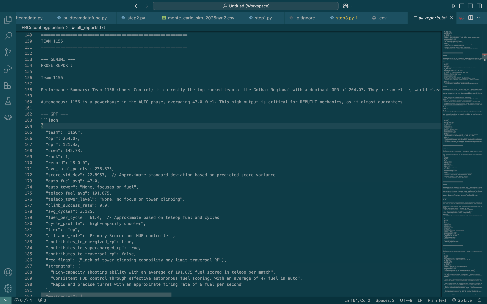

# FRC AI Scouting Pipeline

A multi-stage competitive intelligence pipeline for FIRST Robotics Competition (FRC) events. Built for Team 3158 (PrepaTec TECBOT) during the 2026 season.

## What it does

Pulls live match and team data from The Blue Alliance API, runs a Monte Carlo tournament simulator to predict final rankings, aggregates statistical and human scouting data per team, and runs dual-model AI analysis (Gemini + GPT-4o) to generate structured scouting reports for alliance selection and match strategy.

## Pipeline stages

**base.py** — Scrapes OPR, DPR, CCWM, match predictions, ranking predictions, and stat distributions from the TBA API for a given event. Outputs clean CSVs to data/processed/.

**montecarlo.py** — Simulates the full tournament 1000 times using OPR-based match simulation, with an Energized RP rate calibrated from real match data. Outputs predicted rankings and average RP per team.

**team_data.py** — Aggregates all data sources (TBA stats, Monte Carlo results, human scouting, metadata) into a single structured dict per team. Human scouting is limited to real Gotham matches.

**analysts.py** — Runs each team through Gemini, then GPT-4o, using a structured analyst prompt. Produces prose scouting reports + structured JSON output covering tier rating, cycle profile, alliance role, RP contributions, strengths, weaknesses, and match strategy.

## Sample Output



Each team receives independent analysis from Gemini and GPT-4o covering performance summary, autonomous, teleop, cycle profile, strengths, weaknesses, and match strategy.

## Setup

Requires Python 3.11+.

```bash
pip install -r requirements.txt
cp .env.example .env    # Then fill in your API keys
```

`data/` is not tracked in git. Put the team list and scouting export in `data/raw/` before running: `gotham_2026_teams.csv` and `scouting_datanyc.csv`.

## Project layout

```
pipeline/         Pipeline code
data/raw/         Inputs no script produces (scouting export, team list)
data/processed/   Everything the pipeline writes, including LLM reports; safe to rebuild
evals/            Evaluations (empty for now)
dashboard/        Streamlit dashboard
```

## Usage

Run from the repo root:

```bash
python -m pipeline.base          # Pull and process TBA data
python -m pipeline.montecarlo    # Run tournament simulation
python -m pipeline.analysts      # Generate AI scouting reports
streamlit run dashboard/app.py   # Explore everything in the browser
```

The dashboard works with whichever stages have run so far. Press **Reload data** after a backend run to see the new output.

## Stack

Python, pandas, numpy, The Blue Alliance API, Google Gemini, OpenAI GPT-4o, Streamlit